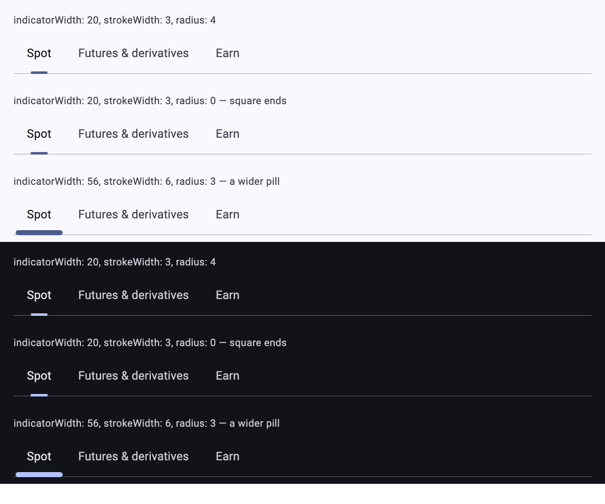
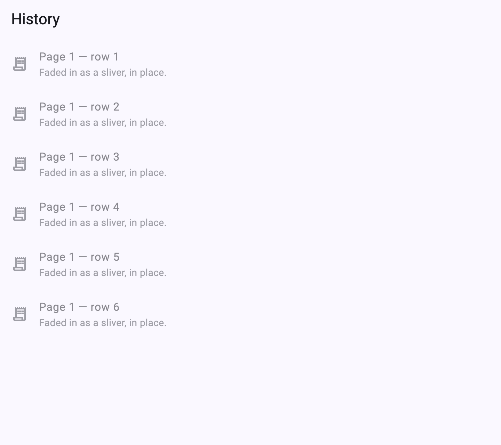

# indicator_tab_bar

A tab indicator that draws a **short bar of a fixed width** under the tab
instead of one stretched across it, and a **sliver `AnimatedSwitcher`** for
cross-fading the body each tab selects.

Nothing here imports Material. `TabBar.indicator` takes a plain `Decoration`,
so the indicator works the same whether the `TabBar` comes from
`package:flutter/material.dart` or from the `material_ui` fork — and the sliver
switcher is pure `flutter/widgets`. No assets, no other pub.dev dependency.



## Install

```bash
flutter pub add indicator_tab_bar
```

Requires Flutter 3.47.0 or newer, and so Dart 3.13.0 or newer — that is the
Flutter release which ships it.

## `LineTabIndicator`

`TabBar` sizes its indicator from `TabBarIndicatorSize`, which offers a choice
between the width of the whole tab and the width of its label — both of which
move as the labels do. This one is neither: `indicatorWidth` is the width it
draws, whatever the tab underneath measures, so a row of tabs with labels of
very different lengths still gets underlines of one length.

```dart
TabBar(
  isScrollable: true,
  tabAlignment: TabAlignment.start,
  indicatorSize: TabBarIndicatorSize.label,
  indicator: LineTabIndicator(
    color: theme.colorScheme.primary,
    strokeWidth: 3,
    indicatorWidth: 20,
    radius: 4,
  ),
  tabs: const [
    Tab(text: 'Spot'),
    Tab(text: 'Futures & derivatives'),
    Tab(text: 'Earn'),
  ],
)
```

The bar is a rounded rectangle sitting on the bottom edge of the tab,
`strokeWidth` tall and **exactly** `indicatorWidth` wide, centred. A tab
narrower than the bar gets one that overhangs it evenly on both sides.

| | |
|---|---|
| `color` | what the bar is filled with |
| `strokeWidth` | its height, growing upwards from the bottom edge — default `3` |
| `indicatorWidth` | its width, independent of the tab — default `50` |
| `radius` | its corner radius, clamped to `strokeWidth / 2` — default `0`, square ends |

`radius` is clamped because past half the height there is nothing left to
round: at or above `strokeWidth / 2` the ends are already semicircles. So
`radius: 4` on a 3-tall bar and `radius: 999` on the same bar draw the same
pill, and the second screenshot row above — `radius: 0` — is the only shape
that reads differently at that thickness.

It is a value type: two indicators with the same fields are `==`, so `TabBar`
does not repaint on a rebuild that changes nothing, and `Decoration.lerp`
interpolates every field, so it animates across a theme change.

## `SliverAnimatedSwitcher`

When the tab body is a **sliver** inside a `CustomScrollView` — a `SliverList`
under a `SliverAppBar`, say — the plain `AnimatedSwitcher` cannot be used, twice
over: it stacks its children in a `Stack`, which is a box, and it wraps them in
box transitions. This keeps the same driving animation but lays the incoming
sliver out on its own and fades it with a `SliverFadeTransition`.

```dart
CustomScrollView(
  slivers: [
    const SliverAppBar(title: Text('History'), pinned: true),
    SliverAnimatedSwitcher(
      duration: const Duration(milliseconds: 250),
      switchInCurve: Curves.easeOut,
      child: SliverList.list(
        // The key is what marks this as a *different* sliver.
        key: ValueKey(tab),
        children: rows,
      ),
    ),
  ],
)
```



As with `AnimatedSwitcher`, the swap is detected by `Widget.canUpdate`: two
slivers of the same runtime type with the same key are the *same* sliver
updated, and nothing animates. Give each branch its own `Key` when they share a
type, as the `SliverList` above does.

`transitionBuilder` replaces the fade with something else — anything that
returns a sliver, so `SliverOpacity` and friends, not `FadeTransition`.

### Only the incoming sliver animates

Slivers cannot be overlaid — there is no sliver `Stack` to hold the old one
over the new — so the outgoing sliver is removed the moment the swap begins,
and what you see is the incoming one fading up in the space it leaves. That is
why there is no `switchOutCurve` or `reverseDuration` here: there would be no
outgoing animation for them to shape.

## Example

`example/` is a runnable app: a scrollable `TabBar` with the indicator under
it, sliders for its three metrics, and a `CustomScrollView` whose body sliver
is swapped per tab.

```bash
cd example && flutter run
```

The images above are rendered from the real widgets, so they can be
regenerated whenever the package changes:

```bash
cd example && flutter test --update-goldens test/screenshots_test.dart
```

## Licence

MIT — see [LICENSE](LICENSE).
